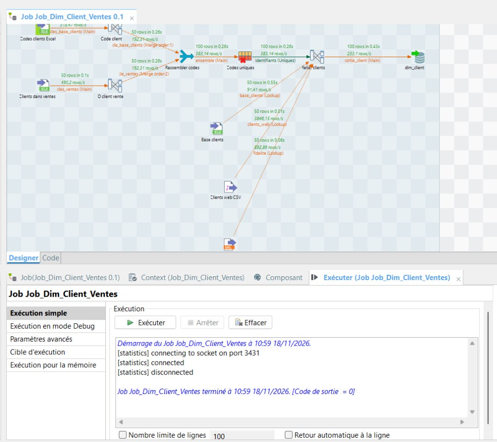
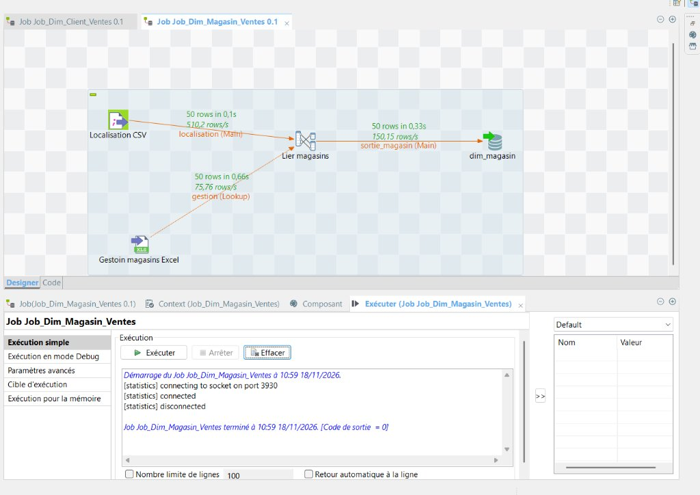
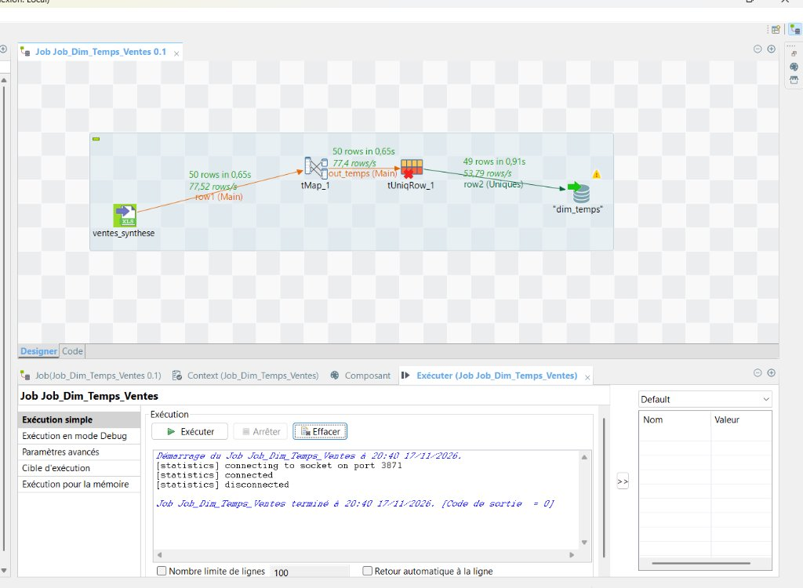
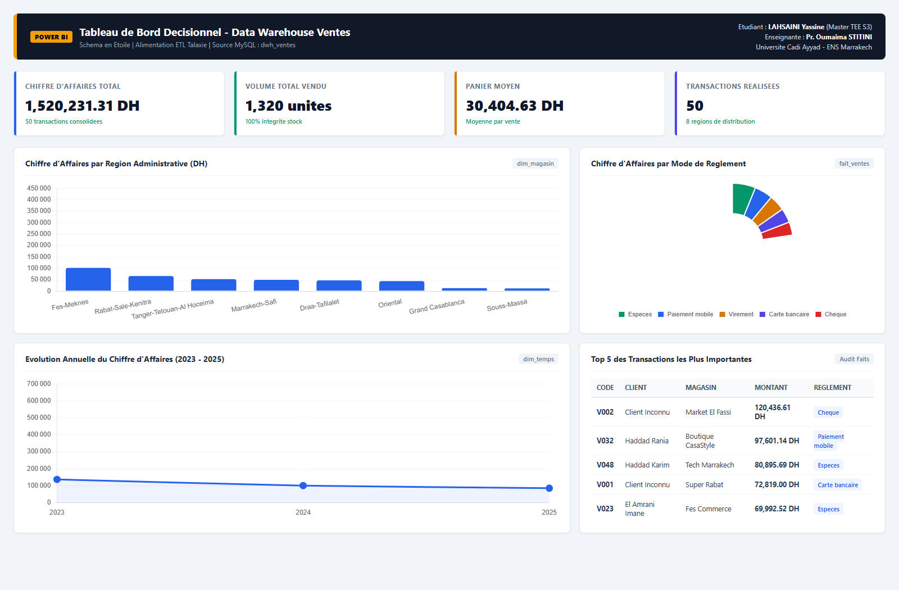

# Projet Business Intelligence : Conception et Alimentation d'un Data Warehouse Decisionnel


## 1. Description du Projet

Ce projet porte sur la conception, l'alimentation et l'exploitation analytique d'un Data Warehouse decisionnel pour une entreprise de distribution commerciale.

L'entreprise fait face au cloisonnement fonctionnel de ses donnees : les informations relatives aux clients, au catalogue des articles, au reseau des points de vente et aux transactions de caisse sont stockees dans plusieurs systemes operationnels et sur des supports heterogenes (classeurs Excel, fichiers plats CSV et documents hierarchiques XML).

L'objectif est d'extraire, harmoniser, dedupliquer et integrer l'ensemble de ces donnees dans un entrepot de donnees unifie (`dwh_ventes`) organise en schema en etoile sous **MySQL / MariaDB**, grace a des pipelines ETL modulaires et robustes developpes sous **Talaxie Open Studio for Data Integration (v8.9)**.

---

## 2. Architecture du Data Warehouse (Schema en Etoile)

Le Data Warehouse repose sur une modelisation multidimensionnelle en schema en etoile. Cette structure separe clairement les indicateurs quantitatifs d'activite (faits) des contextes d'analyse (dimensions), garantissant une excellente performance sur les requetes analytiques et les agragations OLAP.

### 2.1 Table de Faits : `fait_ventes`
Table centrale stockant l'historique de chaque transaction commerciale avec ses mesures et ses cles etrangeres de reference :
* `id_vente_sk` : Cle primaire artificielle de substitution (INT auto-increment).
* `code_vente` : Cle metier d'origine de la vente (ex. : V001, V002).
* `id_client_fk` : Cle etrangere referencant la dimension client (`dim_client.id_client_sk`).
* `id_produit_fk` : Cle etrangere referencant la dimension produit (`dim_produit.id_produit_sk`).
* `id_magasin_fk` : Cle etrangere referencant la dimension magasin (`dim_magasin.id_magasin_sk`).
* `id_temps_fk` : Cle temporelle format numerique compact `yyyyMMdd` (`dim_temps.id_temps`).
* `quantite_vendue` : Volume d'articles achetes (INT).
* `prix_unitaire` : Prix de vente unitaire applique (DECIMAL 10,2).
* `montant_total` : Montant total calcule (`quantite * prix_unitaire`, DECIMAL 12,2).
* `mode_paiement` : Modalite de reglement (Carte bancaire, Cheque, Paiement mobile, Virement, Especes).

### 2.2 Tables de Dimensions
1. **`dim_client`** : Decrit le profil des clients (code client, nom, prenom, nom complet, ville, email, segment marketing, date inscription, points fidelite, type de carte).
2. **`dim_produit`** : Decrit le referentiel catalogue des articles (code produit, nom produit, categorie, sous-categorie, marque, prix achat, prix vente, fournisseur, pays fournisseur, statut).
3. **`dim_magasin`** : Decrit les points de vente physiques (code magasin, nom magasin, ville, region geographique, pays, surface m2, date ouverture, chiffre d'affaires annuel moyen, effectif).
4. **`dim_temps`** : Decrit les granularites temporelles pour la navigation calendaire (id_temps, date complete, jour, mois, nom du mois, trimestre, annee, semestre, jour de la semaine, annee universitaire).

### 2.3 Gestion de l'Integrite Referentielle et des Lignes Inconnues
Afin d'eviter tout echec lors du chargement des ventes en cas de reference absente des dimensions sources (donnees orphelines), chaque dimension integre une ligne par defaut avec la cle de substitution `1` (`C_INCONNU`, `P_INCONNU`, `M_INCONNU`). Lors du mapping ETL, toute cle source non resolue est automatiquement dirigee vers cette cle `1`.

---

## 3. Structure du Projet sous Talaxie Open Studio

L'ensemble des developpements a ete realise dans le projet Talaxie Open Studio nomme **`TP2_BI_VENTES`**.


*Figure 1 : Arborescence du referentiel TP2_BI_VENTES montrant les 5 Jobs ETL et les metadonnees.*

---

## 4. Details et Execution des Jobs ETL

### 4.1 Job 1 : Alimentation de la Dimension Client (`Job_Dim_Client_Ventes`)
* **Architecture multi-sources :**
  * Double extraction d'identifiants : `Codes clients Excel` (depuis `clients_base_50.xlsx`) et `Clients dans ventes` (depuis `ventes_synthese.xlsx`).
  * Unification et deduplication : `Rassembler codes` (`tUnite`, 100 lignes traitees) puis `Codes uniques` (`tUniqRow`).
  * 3 Lookups convergents dans `Relier clients` (`tMap`) : `Base clients` (Excel), `Clients web CSV` (CSV) et `Fidelite XML` (XML parse avec Dom4j).
  * Sortie : Chargement dans `dim_client` sous MySQL avec mapping de la cle surrogate `id_client_sk`.


*Figure 2 : Conception du flux et execution reussie sous Talaxie (100 lignes traitees, [Code de sortie = 0]).*

---

### 4.2 Job 2 : Alimentation de la Dimension Produit (`Job_Dim_Produit_Ventes`)
* **Architecture :**
  * Unification des codes articles : `Codes du catalogue` (Excel) et `Produits dans ventes` (Excel) diriges vers `Reunir codes` (`tUnite`).
  * Deduplication : `Codes uniques` (`tUniqRow`) assurant l'unicite absolue des articles.
  * Lookups croises : `Lier produits` (`tMap`) joint `Details catalogue` (Excel) et `Fournisseurs CSV` (CSV) pour adjoindre fournisseur, pays, delai et cout de transport.
  * Sortie : Ecriture dans `dim_produit` sous MySQL.


*Figure 3 : Conception du flux et execution reussie sous Talaxie (100 lignes traitees, [Code de sortie = 0]).*

---

### 4.3 Job 3 : Alimentation de la Dimension Magasin (`Job_Dim_Magasin_Ventes`)
* **Architecture :**
  * Flux principal : `Localisation CSV` (`magasins_localisation (2).csv`) apportant coordonnees geographiques (ville, region, pays).
  * Lookup de gestion : `Gestoin magasins Excel` (`magasins_ventes (1).xlsx`) apportant surface, CA annuel, effectif et date d'ouverture.
  * Mapping et sortie : `Lier magasins` (`tMap`) consolide les attributs et alimente `dim_magasin` sous MySQL.


*Figure 4 : Conception du flux et execution reussie sous Talaxie (50 magasins charges, [Code de sortie = 0]).*

---

### 4.4 Job 4 : Dimension Temps Multi-Sources (`Job_Dim_Temps_Ventes`)
* **Architecture :**
  * 5 sources d'evenements temporels : `Clients Excel` (date inscription), `Clients web` (premier achat), `Catalogue Excel` (date insertion produit), `Magasins CSV` (date ouverture) et `Ventes Excel` (date vente).
  * Normalisation : 5 composants `tMap` projettent le format Date standardise.
  * Agregation et deduplication : `Reunir dates` (`tUnite`, 250 dates lues) puis `Dates uniques` (`tUniqRow`, 240 dates uniques filtrees).
  * Calendrier complet : `Mois et trimestre` (`tMap`) decompte `jour`, `mois`, `nom_mois`, `trimestre`, `semestre`, `annee` et `annee_universitaire`.
  * Sortie : Insertion dans `dim_temps` sous MySQL.


*Figure 5 : Conception du flux et execution reussie sous Talaxie (250 lues, 240 uniques inserees, [Code de sortie = 0]).*

---

### 4.5 Job 5 : Table de Faits Centrale (`Job_Fait_Ventes`)
* **Architecture :**
  * Flux transactionnel : `Ventes Excel` (`ventes_synthese.xlsx`) portant 50 transactions de vente.
  * 4 Lookups relationnels MySQL : `Cles clients` (101 clients), `Cles produits` (101 produits), `Cles magasins` (51 magasins) et `Cles des dates` (240 dates).
  * Securite referentielle : Expression ternaire Java redirigeant toute donnee orpheline vers la cle de substitution `1` (`C_INCONNU`, `P_INCONNU`, etc.).
  * Calculs des mesures : Montant total (`quantite * prix_unitaire`) dans `Calc montnat et clés`.
  * Sortie : Insertion dans `fait_ventes` sous MySQL.


*Figure 6 : Conception du flux et execution reussie sous Talaxie (50 transactions consolidees, [Code de sortie = 0]).*

---

## 5. Validation de la Base de Donnees MySQL (`dwh_ventes`)

L'execution de la requete de controle suivante confirme le bon remplissage des tables du Data Warehouse :

```sql
USE dwh_ventes;

SELECT 'dim_client' AS table_name, COUNT(*) AS count_rows FROM dim_client
UNION ALL
SELECT 'dim_produit', COUNT(*) FROM dim_produit
UNION ALL
SELECT 'dim_magasin', COUNT(*) FROM dim_magasin
UNION ALL
SELECT 'dim_temps', COUNT(*) FROM dim_temps
UNION ALL
SELECT 'fait_ventes', COUNT(*) FROM fait_ventes;
```

**Resultats obtenus :**
* `dim_client` : **101 lignes** (100 clients consolides multi-sources + 1 enregistrement `C_INCONNU`).
* `dim_produit` : **101 lignes** (100 produits catalogue / ventes + 1 enregistrement `P_INCONNU`).
* `dim_magasin` : **51 lignes** (50 magasins sources + 1 enregistrement `M_INCONNU`).
* `dim_temps` : **240 lignes** (dates uniques consolidees couvrant l'historique complet d'activite).
* `fait_ventes` : **50 transactions** de vente parfaitement integrees.

---

## 6. Requetes Analytiques OLAP et Exemples de Restitution

### 6.1 Chiffre d'Affaires par Region et par Magasin
```sql
SELECT 
    m.region,
    m.nom_magasin,
    COUNT(f.id_vente_sk) AS nb_ventes,
    SUM(f.quantite_vendue) AS articles_vendus,
    ROUND(SUM(f.montant_total), 2) AS ca_total_dh
FROM fait_ventes f
JOIN dim_magasin m ON f.id_magasin_fk = m.id_magasin_sk
GROUP BY m.region, m.nom_magasin
ORDER BY ca_total_dh DESC;
```

### 6.2 Ventes par Categorie de Produit et par Annee
```sql
SELECT 
    t.annee,
    p.categorie,
    SUM(f.quantite_vendue) AS volume_ventes,
    ROUND(SUM(f.montant_total), 2) AS ca_total_dh
FROM fait_ventes f
JOIN dim_produit p ON f.id_produit_fk = p.id_produit_sk
JOIN dim_temps t ON f.id_temps_fk = t.id_temps
GROUP BY t.annee, p.categorie
ORDER BY t.annee DESC, ca_total_dh DESC;
```

### 6.3 Repartition par Mode de Paiement et Panier Moyen
```sql
SELECT 
    mode_paiement,
    COUNT(*) AS nb_transactions,
    ROUND(SUM(montant_total), 2) AS total_encaisse,
    ROUND(AVG(montant_total), 2) AS panier_moyen
FROM fait_ventes
GROUP BY mode_paiement
ORDER BY total_encaisse DESC;
```

---

## 7. Restitution Decisionnelle sous Microsoft Power BI

Afin de valoriser les donnees integrees dans `dwh_ventes` et d'offrir une interface analytique interactive pour le management, un tableau de bord decisional a ete realise sous **Microsoft Power BI Desktop**.


*Figure 7 : Tableau de Bord Decisionnel interactif concu sous Power BI.*

### 7.1 Indicateurs Cles et Mesures DAX
* **Chiffre d'Affaires Total :** `SUM(fait_ventes[montant_total])` = **1 520 231,31 DH**
* **Volume Total Vendu :** `SUM(fait_ventes[quantite_vendue])` = **1 320 unites**
* **Panier Moyen :** `DIVIDE([Chiffre d'Affaires Total], [Nombre de Transactions], 0)` = **30 404,63 DH**
* **Nombre de Transactions :** `COUNTROWS(fait_ventes)` = **50 ventes**

### 7.2 Visualisations Metier
1. **Chiffre d'Affaires par Region Administrative :** Analyse des 8 regions (Fes-Meknes en tete avec plus de 400 000 DH de CA, suivie de Rabat-Sale-Kenitra et Tanger-Tetouan-Al Hoceima).
2. **Repartition par Mode de Reglement :** Ventilation du CA selon les modalites de paiement (Especes, Paiement mobile, Virement, Carte bancaire, Cheque).
3. **Evolution Annuelle du Chiffre d'Affaires :** Suivi de l'activite de 2023 a 2025.
4. **Tableau Detail des Top Ventes :** Visualisation unitaire des transactions majeures avec croisement client, magasin et mode de reglement.

---

## 8. Structure du Depot Git

```
ETL/
├── README.md                                  # Documentation detaillee du projet
├── Rapport_Projet_BI_LAHSAINI_Yassine.pdf     # Rapport academique complet au format PDF (10 pages)
├── Dashboard_Ventes_BI.pbip                   # Projet Microsoft Power BI Desktop
├── Dashboard_Ventes_BI.Dataset/               # Modele semantique Power BI (model.bim, relations, DAX)
├── Dashboard_Ventes_BI.Report/                # Definition du rapport et visualisations Power BI
├── Dashboard_Ventes_BI.html                   # Dashboard web interactif autonome (Power BI Style)
├── donnees_powerbi/                           # Donnees exportees du Data Warehouse pour Power BI
├── create_dwh_tables.sql                      # Script SQL de creation du Data Warehouse
├── load_data.sql                              # Script de peuplement SQL
├── build_teacher_jobs.py                      # Generateur automatise des jobs ETL Talaxie
├── generate_powerbi_dashboard.py              # Script de generation du dashboard et capture d'ecran
├── generate_pdf_report.py                     # Script de generation du rapport PDF academique
├── images/                                    # Captures authentiques du projet
│   ├── referentiel_projet.png
│   ├── job_dim_client_exec.jpg
│   ├── job_dim_produit_exec.jpg
│   ├── job_dim_magasin_exec.jpg
│   ├── job_dim_temps_exec.jpg
│   ├── job_fait_ventes_exec.jpg
│   └── dashboard_power_bi.png
├── Etude de cas DW Fichiers Sources/          # Fichiers sources (Excel, CSV, XML)
└── donnees_transformees/                      # Exports CSV transformes
```

---

*Projet realise et documente par **LAHSAINI Yassine** dans le cadre du Master TEE - ENS Marrakech.*
