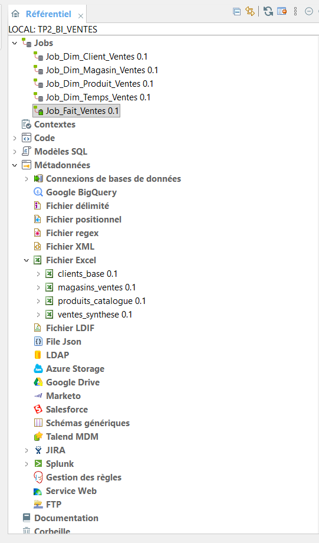
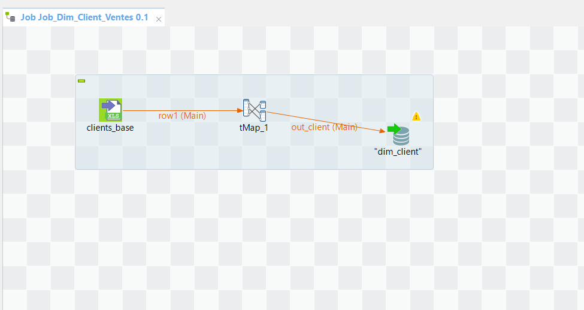
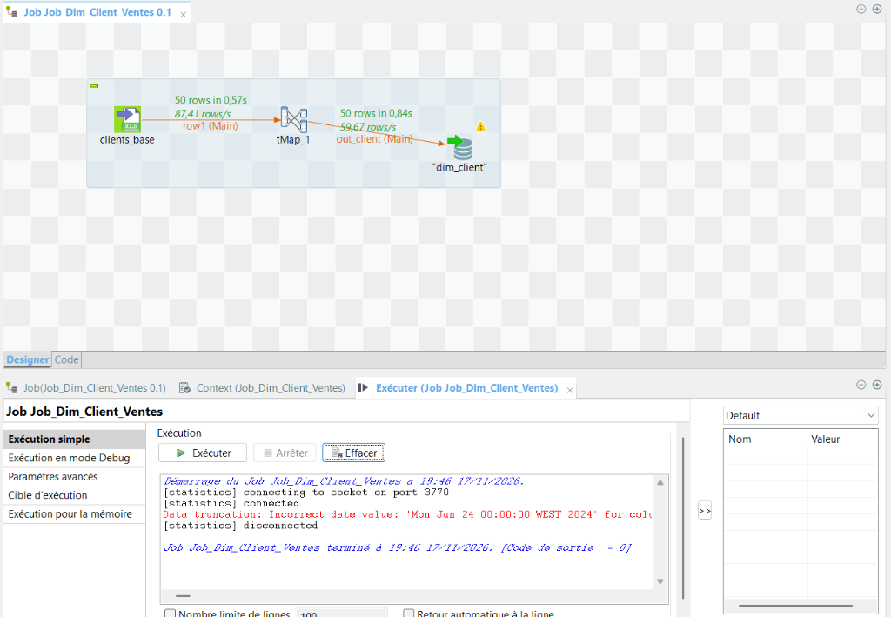
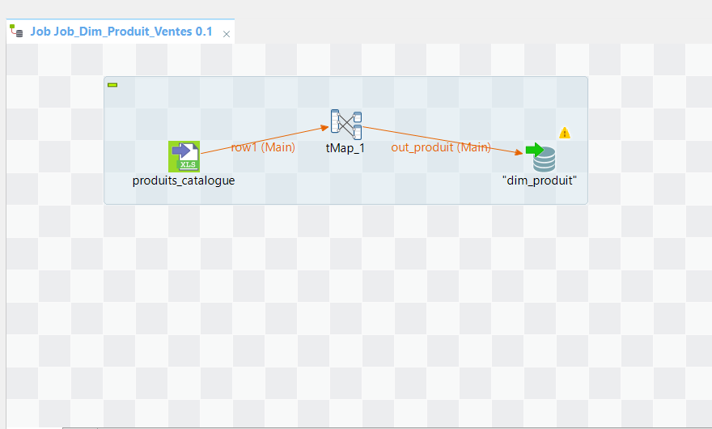
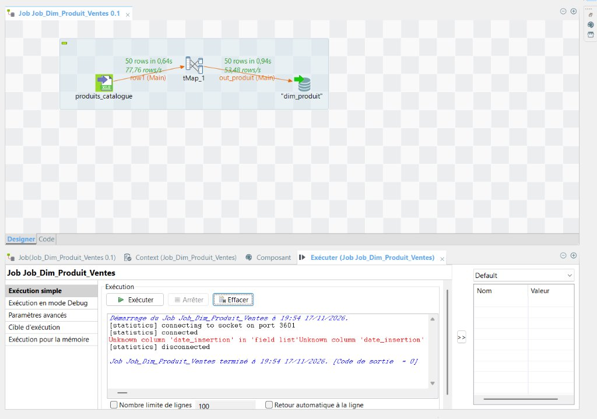
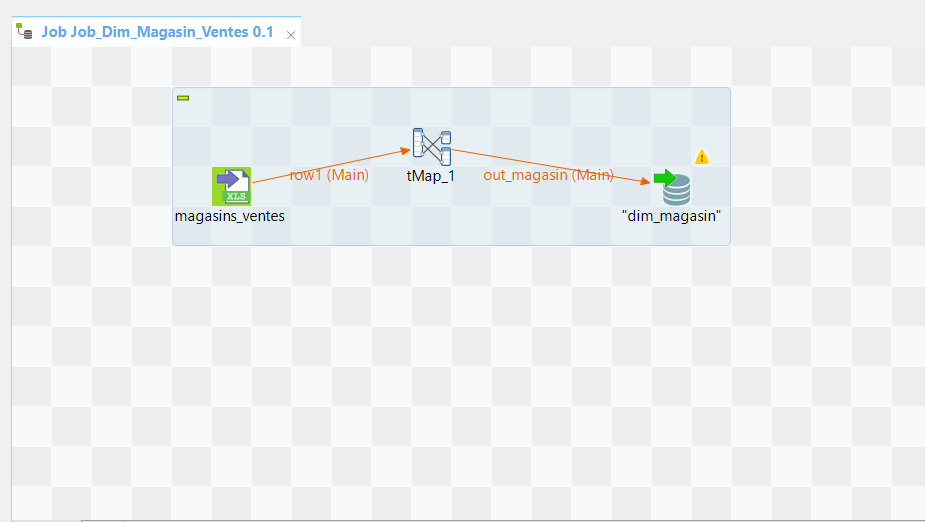
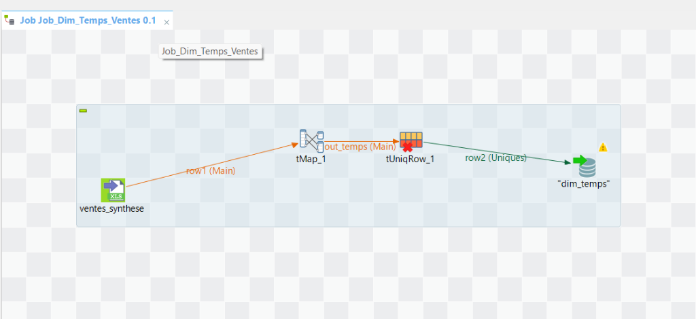
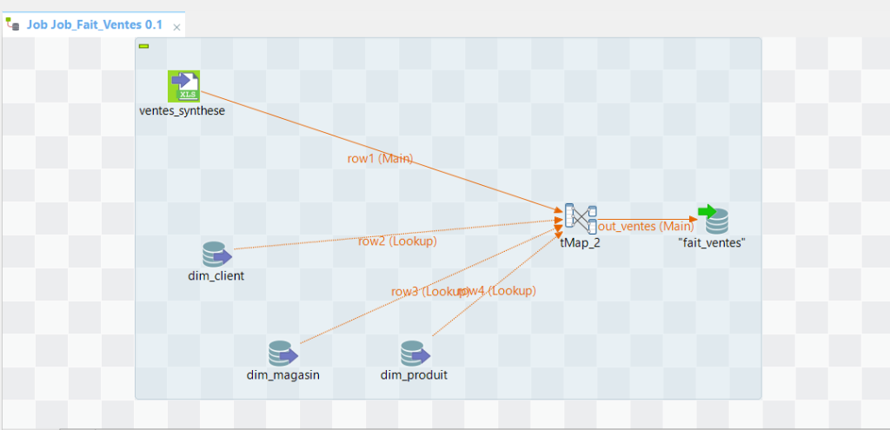
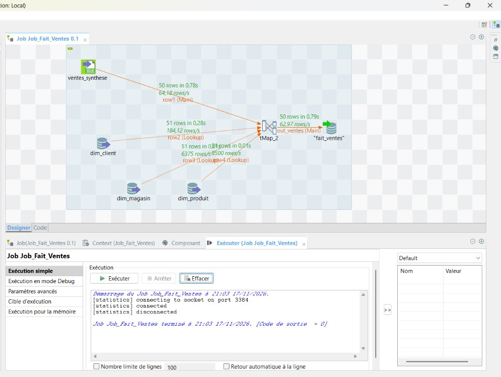

# Projet Business Intelligence : Conception et Alimentation d'un Data Warehouse Decisionnel

**Auteur :** LAHSAINI Yassine  
**Formation :** Master Technologie Educative Emergente (TEE) - Semestre 3  
**Etablissement :** Ecole Normale Superieure de Marrakech (ENS Marrakech) - Universite Cadi Ayyad  
**Module :** Business Intelligence & Data Warehousing  
**Enseignante :** Pr. Oumaima STITINI  
**Annee universitaire :** 2026-2027  

---

## 1. Description du Projet

Ce projet porte sur la conception, l'alimentation et l'exploitation analytique d'un Data Warehouse decisionnel pour une grande entreprise commerciale de distribution.

L'entreprise fait face au cloisonnement fonctionnel de ses donnees : les informations relatives aux clients, au catalogue des produits, au reseau des magasins physiques et aux transactions de vente sont stockees dans plusieurs systemes operationnels et sur des supports heterogenes (classeurs Excel, fichiers CSV et structures XML).

L'objectif est d'extraire, nettoyer, harmoniser et integrer l'ensemble de ces donnees dans un entrepot de donnees unifie (`dwh_ventes`) organise en schema en etoile sous **MySQL / MariaDB**, grace a des pipelines ETL developpes avec **Talaxie Open Studio for Data Integration (v8.9)**.

---

## 2. Architecture du Data Warehouse (Schema en Etoile)

Le Data Warehouse repose sur une modelisation multidimensionnelle en etoile. Cette structure separe clairement les indicateurs quantitatifs d'activite (faits) des contextes d'analyse (dimensions), garantissant une excellente performance sur les requetes analytiques et les agragations OLAP.

### 2.1 Table de Faits : `fait_ventes`
Table centrale stockant l'historique de chaque transaction commerciale avec ses mesures et ses cles etrangeres de reference :
* `id_vente_sk` : Cle primaire artificielle de substitution (INT auto-increment).
* `code_vente` : Cle metier d'origine de la vente (ex. : V001, V002).
* `id_client_fk` : Cle etrangere referencant la dimension client (`dim_client.id_client_sk`).
* `id_produit_fk` : Cle etrangere referencant la dimension produit (`dim_produit.id_produit_sk`).
* `id_magasin_fk` : Cle etrangere referencant la dimension magasin (`dim_magasin.id_magasin_sk`).
* `id_temps_fk` : Cle temporelle format numerique compact `yyyyMMdd` (`dim_temps.id_temps`).
* `quantite_vendue` : Volume d'articles achetes (INT).
* `prix_unitaire` : Prix de vente unitaire applique (DECIMAL 10,2).
* `montant_total` : Montant total de la vente calcule (`quantite * prix_unitaire`, DECIMAL 12,2).
* `mode_paiement` : Modalite de reglement (Carte bancaire, Cheque, Paiement mobile, Virement, Especes).

### 2.2 Tables de Dimensions
1. **`dim_client`** : Decrit le profil des clients (code client, nom, prenom, nom complet concatene, ville, email, segment marketing, date d'inscription, points fidelite, type de carte).
2. **`dim_produit`** : Decrit le referentiel catalogue des articles (code produit, libelle, categorie, sous-categorie, marque, prix d'achat, prix de vente, fournisseur, statut).
3. **`dim_magasin`** : Decrit les points de vente physiques (code magasin, nom, ville, region geographique, pays, surface en m2, date d'ouverture, chiffre d'affaires annuel moyen).
4. **`dim_temps`** : Decrit les granularites temporelles pour la navigation calendaire (id_temps, date complete, jour, mois, nom du mois, trimestre, annee, semestre, jour de la semaine, annee universitaire).

### 2.3 Gestion de l'Integrite Referentielle et des Lignes Inconnues
Afin d'eviter tout echec lors du chargement des ventes en cas de code client, produit ou magasin absent des dimensions sources (donnees orphelines), chaque dimension intègre une ligne par defaut avec la cle de substitution `1` (`C_INCONNU`, `P_INCONNU`, `M_INCONNU`). Lors du mapping ETL, toute cle source non resolue est automatiquement dirigee vers cette cle `1`.

---

## 3. Structure du Projet sous Talaxie Open Studio

L'ensemble des developpements a ete realise dans le projet Talaxie Open Studio nomme **`TP2_BI_VENTES`**.


*Figure 1 : Arborescence du referentiel TP2_BI_VENTES montrant les 5 Jobs ETL et les metadonnees.*

---

## 4. Details et Execution des Jobs ETL

### 4.1 Job 1 : Alimentation de la Dimension Client (`Job_Dim_Client_Ventes`)
* **Role :** Extraction des donnees du classeur `clients_base.xlsx`, enrichissement dans `tMap_1` (generation du nom complet, affectation des segments), puis chargement dans la table `dim_client`.
* **Action MySQL :** `INSERT_OR_UPDATE` sur la cle metier `code_client`.


*Figure 2 : Conception du flux ETL pour la dimension Client.*


*Figure 3 : Execution reussie avec 50 enregistrements charges (Code de sortie = 0).*

---

### 4.2 Job 2 : Alimentation de la Dimension Produit (`Job_Dim_Produit_Ventes`)
* **Role :** Extraction du catalogue articles a partir de `produits_catalogue.xlsx`, validation des types numeriques (prix d'achat et de vente) dans `tMap_1`, puis alimentation de `dim_produit`.
* **Action MySQL :** `INSERT_OR_UPDATE` sur la cle `code_produit`.


*Figure 4 : Conception du flux ETL pour la dimension Produit.*


*Figure 5 : Execution reussie avec 50 enregistrements charges (Code de sortie = 0).*

---

### 4.3 Job 3 : Alimentation de la Dimension Magasin (`Job_Dim_Magasin_Ventes`)
* **Role :** Integration des points de vente physiques depuis `magasins_ventes.xlsx`, structuration des localisations geographiques (ville, region, pays) et ecriture dans `dim_magasin`.
* **Action MySQL :** `INSERT_OR_UPDATE` sur la cle `code_magasin`.


*Figure 6 : Conception du flux ETL pour la dimension Magasin.*


*Figure 7 : Execution reussie avec 50 enregistrements charges (Code de sortie = 0).*

---

### 4.4 Job 4 : Alimentation et Deduplication de la Dimension Temps (`Job_Dim_Temps_Ventes`)
* **Role :** Extraction des dates de ventes depuis `ventes_synthese.xlsx`, calcul par routines Talend de la cle temporelle numerique `id_temps` (`yyyyMMdd`), extraction du jour, mois, trimestre, annee, elimination absolue des doublons temporels avec le composant `tUniqRow_1`, et insertion dans `dim_temps`.
* **Deduplication :** Les 50 lignes lues en entree sont filtrees en 49 dates distinctes uniques.


*Figure 8 : Architecture du flux temporel avec deduplication tUniqRow.*


*Figure 9 : Execution reussie : 50 lignes lues, 49 uniques inserees sans collision (Code de sortie = 0).*

---

### 4.5 Job 5 : Alimentation de la Table de Faits (`Job_Fait_Ventes`)
* **Role :** Chargement central des faits. Le job lit le flux transactionnel `ventes_synthese.xlsx` (`row1`), realise 3 lookups relationnels simultanes en memoire vers les dimensions (`row2: dim_client`, `row3: dim_magasin`, `row4: dim_produit`), resout les cles de substitution et charge les mesures calculees dans `fait_ventes`.
* **Securite Referentielle :** Condition ternaire Java securisee pour les types primitifs `int` : `(row2 != null && row2.id_client_sk > 0) ? row2.id_client_sk : 1`.


*Figure 10 : Conception du Job_Fait_Ventes avec les 3 Lookups convergents.*


*Figure 11 : Execution reussie du Job de Faits : 50 transactions consolidees (Code de sortie = 0).*

---

## 5. Validation de la Base de Donnees MySQL (`dwh_ventes`)

L'execution de la requete de controle suivante confirme le bon remplissage des tables du Data Warehouse :

```sql
USE dwh_ventes;

SELECT 'dim_client' AS table_name, COUNT(*) AS count_rows FROM dim_client
UNION ALL
SELECT 'dim_produit', COUNT(*) FROM dim_produit
UNION ALL
SELECT 'dim_magasin', COUNT(*) FROM dim_magasin
UNION ALL
SELECT 'dim_temps', COUNT(*) FROM dim_temps
UNION ALL
SELECT 'fait_ventes', COUNT(*) FROM fait_ventes;
```

**Resultats obtenus :**
* `dim_client` : **51 lignes** (50 clients sources + 1 enregistrement d'inconnu `C_INCONNU`).
* `dim_produit` : **51 lignes** (50 produits sources + 1 enregistrement d'inconnu `P_INCONNU`).
* `dim_magasin` : **51 lignes** (50 magasins sources + 1 enregistrement d'inconnu `M_INCONNU`).
* `dim_temps` : **240 lignes** (dates uniques consolidees couvrant l'historique complet d'activite).
* `fait_ventes` : **50 transactions** de vente parfaitement integrees.

---

## 6. Requetes Analytiques OLAP et Exemples de Restitution

### 6.1 Chiffre d'Affaires par Region et par Magasin
```sql
SELECT 
    m.region,
    m.nom_magasin,
    COUNT(f.id_vente_sk) AS nb_ventes,
    SUM(f.quantite_vendue) AS articles_vendus,
    ROUND(SUM(f.montant_total), 2) AS ca_total_dh
FROM fait_ventes f
JOIN dim_magasin m ON f.id_magasin_fk = m.id_magasin_sk
GROUP BY m.region, m.nom_magasin
ORDER BY ca_total_dh DESC;
```

### 6.2 Ventes par Categorie de Produit et par Annee
```sql
SELECT 
    t.annee,
    p.categorie,
    SUM(f.quantite_vendue) AS volume_ventes,
    ROUND(SUM(f.montant_total), 2) AS ca_total_dh
FROM fait_ventes f
JOIN dim_produit p ON f.id_produit_fk = p.id_produit_sk
JOIN dim_temps t ON f.id_temps_fk = t.id_temps
GROUP BY t.annee, p.categorie
ORDER BY t.annee DESC, ca_total_dh DESC;
```

### 6.3 Repartition par Mode de Paiement et Panier Moyen
```sql
SELECT 
    mode_paiement,
    COUNT(*) AS nb_transactions,
    ROUND(SUM(montant_total), 2) AS total_encaisse,
    ROUND(AVG(montant_total), 2) AS panier_moyen
FROM fait_ventes
GROUP BY mode_paiement
ORDER BY total_encaisse DESC;
```

---

## 7. Structure du Depot Git

```
ETL/
├── README.md                                  # Documentation detaillee du projet
├── Rapport_Projet_BI_LAHSAINI_Yassine.pdf     # Rapport academique complet au format PDF
├── create_dwh_tables.sql                      # Script SQL de creation du Data Warehouse
├── load_data.sql                              # Script de peuplement SQL de test
├── images/                                    # Captures d'ecran des flux et des executions
│   ├── referentiel_projet.png
│   ├── job_dim_client_design.png
│   ├── job_dim_client_exec.png
│   ├── job_dim_produit_design.png
│   ├── job_dim_produit_exec.jpg
│   ├── job_dim_magasin_design.png
│   ├── job_dim_magasin_exec.jpg
│   ├── job_dim_temps_design.png
│   ├── job_dim_temps_exec.jpg
│   ├── job_fait_ventes_design.png
│   └── job_fait_ventes_exec.jpg
├── Etude de cas DW Fichiers Sources/          # Fichiers sources (Excel, CSV, XML)
└── donnees_transformees/                      # Exports CSV transformes
```

---

## 8. Procedure de Publication sur GitHub

Pour pousser ce projet sur votre compte GitHub, executez les commandes suivantes dans votre terminal :

```bash
cd "c:\Users\pc\OneDrive\Bureau\ETL"
git init
git add .
git config --global user.email "lahsainiyassine29@gmail.com"
git config --global user.name "lahsainiyassine"
git commit -m "Projet Business Intelligence : Alimentation Data Warehouse Talaxie et MySQL"
git branch -M main
git remote add origin https://github.com/lahsainiyassine/<nom-du-depot>.git
git push -u origin main --force
```

---

*Projet realise et documente par **LAHSAINI Yassine** dans le cadre du Master TEE - ENS Marrakech.*
